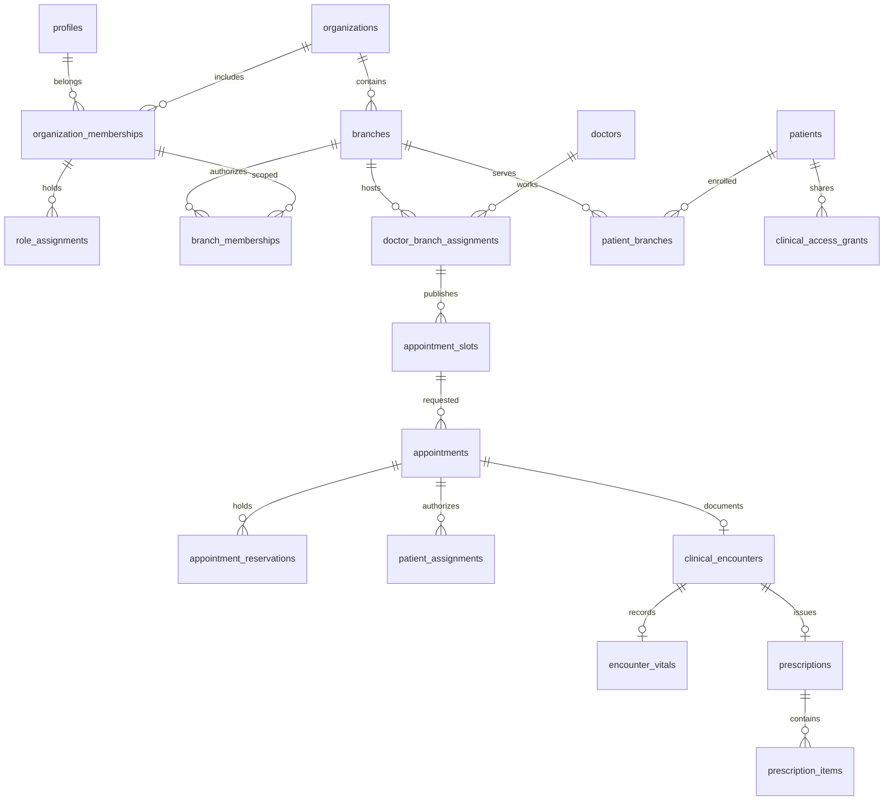

# Phase 2A database architecture

Status: **implemented and validated in isolated PostgreSQL 17.11 staging; protected deployment awaits explicit approval**. Candidate project: `jyigxpjvygvtvcypujel`. See [final runtime validation](phase2a5-final-validation.md), [security readiness review](phase2a-security-review.md), [review plan](phase2a-plan.md), [migration safety](migration-safety.md), and [environment boundaries](environment.md).

## Relationships and tenant boundaries

There are 34 public tables and one private invitation-secret table. Every public table has enabled/forced RLS. Anonymous users have no table or RPC grants. Ordinary authenticated users receive SELECT only, plus the single `notification_recipients.read_at` UPDATE column. All other client writes use scoped database commands.

- `profiles.id` references the managed `auth.users.id`; no Auth users, password flows or provisioning trigger are installed by migrations. Role and branch assignments live in protected tables, never user-editable JWT metadata. Multiple roles per organization are supported.
- Organization IDs are carried through domain relationships using composite foreign keys. A valid UUID from another organization cannot be attached to a patient, branch, doctor, appointment, encounter, document or prescription in this organization.
- `patient_branches` permits multi-branch care while `home_branch_id` preserves the existing patient default. User branch membership is a separate authorization requirement, not implied by enrollment or a grant.
- Doctor professional data and branch fees/durations are separated. `public_email` is professional contact information; private account email remains in `profiles`.
- Specializations, symptom categories and their many-to-many map are normalized. They support browsing, not automated diagnosis.
- Schedules contain one weekday/time window per row; breaks are child rows and must lie within the window. Published slots are UTC intervals, validated against branch-local schedules, grid alignment, duration, breaks, active doctor/branch/assignment and leave at reservation time.
- Invitations have admin-only metadata. A unique 32-byte token hash belongs in `clinic_private.invitation_secrets`; raw tokens are not persisted or exposed. Sending, accepting, expiration jobs and account creation are Phase 2B work.
- Medical history keeps unknown values as NULL and records a review state. Encounter vitals are a separate one-to-one relation. Clinical notes, prescriptions and medication rows are normalized; draft notes/Rx persist for the authorized care team and become patient-readable only when signed.
- Medical documents hold scoped metadata and an optional private storage object key, never a public URL. No bucket, storage policy, upload or download implementation is included. A future document-content release must separately enforce private Storage policies.
- Charges snapshot the fee at booking in integer paisa; zero charges are waived. Manual payment records are append-only structures. No client payment-write capability or gateway is released in 2A.
- Notifications have per-user recipients and contain a generic message, never copied symptoms/clinical notes or tokens. Audit/status-history entries are append-only; command audits record actor/action/entity IDs without clinical payloads.

## Permission matrix

All access below requires an active profile, organization and organization membership. Clinical and appointment access additionally requires current branch membership. Membership removal hides rows without deleting retained clinical data. Membership/role/grant changes are read from tables on each request, so stale JWT role metadata cannot preserve access.

| Resource/action                                    | Branch-authorized Admin                                                | Assigned active Doctor                                                  | Other Doctor / clinical staff                              | Patient                                                |
| -------------------------------------------------- | ---------------------------------------------------------------------- | ----------------------------------------------------------------------- | ---------------------------------------------------------- | ------------------------------------------------------ |
| Organization/role metadata                         | Own organization; protected writes denied                              | Own memberships/roles                                                   | Own memberships/roles                                      | Own memberships/roles                                  |
| Branch/doctor/specialty catalogs                   | Authorized branches                                                    | Authorized branches                                                     | Authorized branches                                        | Authorized branches                                    |
| Patient demographics/baseline history/documents    | Patients enrolled in authorized branch                                 | Approved active care assignment in that branch                          | Explicit unexpired, unrevoked grant in that branch         | Own patient, within current branch scope               |
| Appointments / requests / status history / charges | Authorized branch                                                      | Own assigned appointments                                               | No operational appointment authority from a clinical grant | Own appointments within branch scope                   |
| Pending booking → clinical access                  | Oversight already authorized                                           | **No**; approval creates care assignment                                | No                                                         | Own baseline remains visible                           |
| Draft clinical notes/vitals/Rx                     | Authorized branch oversight                                            | Approved care assignment                                                | Explicit clinical read grant                               | **Denied**                                             |
| Signed notes/vitals/Rx                             | Authorized branch oversight                                            | Approved care assignment                                                | Explicit clinical read grant                               | Own signed records within branch scope                 |
| Book appointment                                   | Authorized branch/enrolled patient                                     | Own identity and existing active primary care assignment in that branch | Denied                                                     | Self, enrolled and authorized branch, source `patient` |
| Approve/reject/check in/start/no-show              | Authorized branch                                                      | Assigned Doctor                                                         | Denied                                                     | Denied                                                 |
| Request reschedule/cancellation                    | Authorized appointment                                                 | Assigned appointment                                                    | Denied                                                     | Own authorized appointment                             |
| Author/sign encounter                              | Denied                                                                 | Assigned Doctor only, appointment in consultation                       | Denied even with write grant                               | Denied                                                 |
| Grant/revoke clinical access                       | Explicit, bounded, audited grant to an existing branch clinician       | Denied                                                                  | Denied                                                     | Denied                                                 |
| Notification read/read marker                      | Own recipient rows                                                     | Own recipient rows                                                      | Own recipient rows                                         | Own recipient rows                                     |
| Audit/invitation metadata                          | Branch-scoped; organization-level generic audit for organization Admin | Denied                                                                  | Denied                                                     | Denied                                                 |
| Private invitation hash / authority table DML      | Denied                                                                 | Denied                                                                  | Denied                                                     | Denied                                                 |

`can_write` on a clinical grant expresses a capability for later reviewed clinical editing commands. It does not grant SQL UPDATE, appointment management, or permission to sign another doctor's encounter in 2A. No general medical-history/document write endpoint is released yet.

An organization-wide Admin must have explicit memberships in every branch they oversee. Doctor-wide leave requires the Doctor themself or an Admin authorized at every active assigned branch. Patients also lose branch-scoped record access when branch membership is revoked; any later patient-history portability exception needs an explicit policy review.

A Doctor cannot create an initial relationship with an unrelated existing patient by self-booking and approving it. Initial care requires a Patient request or trusted Admin intake; a temporary clinical grant alone does not permit Doctor follow-up booking. Deactivating a primary appointment assignment also removes that Doctor's operational modification and signing authority for that visit. Cancelled/rejected/no-show operational history remains readable to its assigned branch-authorized Doctor. A future new-patient walk-in intake command needs separate authorization review.

The trusted service role can provision identity/catalog metadata, but receives no direct SELECT or mutation grants on appointment, reservation, clinical, charge, payment, notification or audit tables. Those workflows use ordinary user JWTs and scoped RPCs. The service role remains privileged because it bypasses RLS on the identity/catalog tables it can access. Future provisioning endpoints must validate the human administrator and perform their own reviewed/audited transaction; service credentials must never reach Web client/Expo code.

## Transaction commands

Eight public RPC functions are `SECURITY INVOKER`, delegating to guarded implementations in the non-exposed `clinic_private` schema. All have a fixed empty search path and explicit ACLs. Private implementation execution is granted only where needed; internal event/lock/slot-check and trigger functions are not directly executable by authenticated clients. Do not add `clinic_private` to Data API exposed schemas.

| RPC                           | Enforcement                                                                                                                                                                                               |
| ----------------------------- | --------------------------------------------------------------------------------------------------------------------------------------------------------------------------------------------------------- |
| `available_appointment_slots` | RLS-scoped doctor availability without exposing another patient's holds or details; excludes invalid/break/leave/held slots. This is a snapshot, not a reservation.                                       |
| `book_appointment`            | Derives organization, doctor identity, status, interval and fee from authoritative rows; locks doctor identity; inserts appointment + original hold + charge + notification/audit/history atomically.     |
| `request_reschedule`          | Locks doctor then appointment; validates same branch/doctor; preserves original hold and adds/replaces proposed hold. A conflict rolls back the whole request.                                            |
| `transition_appointment`      | Checks role/branch/ownership and status transitions; only managers approve. Reschedule approval atomically moves the original hold and clears the proposal. Completion is not available through this RPC. |
| `save_encounter`              | Assigned Doctor only; persists draft notes/vitals/Rx. Signing requires diagnosis/plan and complete medication entries; atomically signs/locks clinical data, completes visit and releases holds.          |
| `grant_clinical_access`       | Branch Admin only; recipient already has active clinician role and branch membership; explicit reason, read/write flag and expiry (maximum one year). Never creates a role or membership.                 |
| `revoke_clinical_access`      | Branch Admin only; immediate revocation and audit.                                                                                                                                                        |
| `add_doctor_leave`            | Shared doctor lock; refuses overlap with checked-in/active consultations; blocks new reservations and flags pending/confirmed affected visits for resolution.                                             |

## Reservation and concurrency rules

`appointment_reservations` stores original/proposed half-open UTC ranges `[start,end)`. GiST exclusion constraints reject overlapping holds for the same clinician identity or patient when they belong to different appointments. A doctor's identity is the profile UUID, so separate branches and separate organization-specific doctor records cannot book the same person simultaneously. Original/proposed holds of the _same_ appointment may overlap; they still block competing appointments. Adjacent intervals are valid.

Booking, rescheduling, transitions, signing and leave acquire the same transaction-scoped advisory lock keyed by clinician profile before locking appointment rows. Hash collisions can serialize unrelated doctors but cannot permit overlap. PostgreSQL's exclusion constraint remains the independent final guard and waits for conflicting transactions; a stale availability result cannot bypass it. Clients should handle `23P01` as a conflict and retry discovery, not silently rebook a different slot.

Pending/confirmed/reschedule/cancellation requests hold capacity. Completed/cancelled/rejected/no-show rows release it. `doctor_unavailable` retains holds until human resolution, a deliberate safer difference from the Phase 1 in-memory availability list. Cancellation requests never free capacity early. Leave and appointment writes share the doctor lock.

Calendar triggers now require schedule/break/Doctor-branch provisioning edits to use the same doctor-identity lock, preserve calendar identity and reject capacity changes that invalidate future holds. Fee-only edits preserve existing booked charges. Branch timezone changes validate the timezone and reject changes while future holds exist. Scoped multi-backend lock ordering and new-assignment races were validated in Phase 2A.5; administrative editing endpoints and broader deadlock/load testing remain future work. Patient profile IDs are organization-local; cross-organization patient duplicate identity matching is not implemented.

Mutating appointment commands recheck caller authority after potentially blocking Doctor/appointment locks; a revoked primary assignment cannot be restored or signed by its former Doctor. Doctor rows are key-share locked while deriving the clinician advisory-lock key. The migration owner must bypass FORCE RLS, and the foundation rejects an unsuitable owner or a non-17 PostgreSQL server. Built-in defaults are explicitly `pg_catalog` qualified; migration search paths put `pg_catalog` first.

Signed encounters, vitals and prescriptions reject ordinary UPDATE/DELETE/reparent/append attempts through their guards. App/Admin/service-role credentials have no direct clinical DML grants. A database owner/superuser can still disable triggers or perform privileged maintenance; this is not tamper-proof storage. Future amendments must append a linked revision with original ID, author, timestamp, reason and fresh signature plus an audit event, preserving the original. Document binary immutability, private Storage authorization and document versioning require a separate review before document writes are enabled.

Local PostgreSQL tests exercise actual RLS, SQLSTATE denials, constraints and rollback. WASM executes one connection, so it cannot prove blocking/deadlock behavior between independent backends. Phase 2A.5 subsequently exercised independent PostgreSQL 17.11 clients and real Auth/PostgREST in explicitly approved staging; the [final report](phase2a5-final-validation.md) records the exact scope and remaining gates. The older `tests/database/booking-race.spec` isolationtester file itself was not executed.

Timezone changes also take a branch-row FOR UPDATE lock before enumerating Doctors and checking future holds. This prevents a new Doctor/branch assignment from committing through its FK KEY SHARE lock after the timezone guard's snapshot. The native phantom regression reproduced the earlier invalid hold and verified the corrected lock/booking behavior. Administrative callers must still handle bounded lock/deadlock failures through reviewed retry behavior.

## Existing TypeScript contracts

No existing entity fields, UI permissions, mock repository methods or app adapters were removed or changed. New type-only exports contain a Supabase-shaped `Database`, row/insert/update/relationship metadata and RPC args/results, generated from the local migration catalog with `pnpm db:types`. Existing appointment status/type unions are checked at compile time against database enums. No private-schema types or secret values are exported.

| Existing mock contract                                | Database mapping / required Phase 2B change                                                                                                    |
| ----------------------------------------------------- | ---------------------------------------------------------------------------------------------------------------------------------------------- |
| String IDs such as `p1` / `APT-101`                   | UUID database IDs; keep UI ID type `string`, add a separate human display reference if required. Never use fixture IDs as real identities.     |
| One `ClinicState.organization` and `UserProfile.role` | Memberships support multiple organizations/roles; select an authorized context. The UI persona selector cannot establish authorization.        |
| `UserProfile.branchIds`                               | Derived from active branch memberships, never client-writable authority.                                                                       |
| `twoFactorEnabled`                                    | Derive from verified Auth MFA factors in 2B; no authoritative boolean added or MFA flow implemented here.                                      |
| Doctor email                                          | Map from professional `public_email` where appropriate; do not expose private profile email in the doctor directory.                           |
| Fee in rupees                                         | Convert exact integer paisa at the adapter boundary; never calculate authoritative charges in the browser.                                     |
| Appointment date/time/requestedSlot                   | Derive branch wall times from referenced UTC slots and active proposed reservation. Duration comes from slot interval.                         |
| Schedule `days[]` and inline breaks                   | Group weekday rows and join child break rows in the adapter.                                                                                   |
| Medical history strings/empty arrays                  | NULL + review state distinguish unknown from reviewed-negative history; render explicitly.                                                     |
| Consultation / nested vitals / prescription items     | Join encounter/vitals/prescription/item rows; only issued/signed records enter Patient projections.                                            |
| `MedicalDocument.demoOnly: true`                      | Keep the mock type unchanged. Real records need a separate reviewed document DTO/storage adapter; do not cast remote content to a demo record. |
| Invitation raw demo `token`                           | Keep demo preview unchanged. Production invitation metadata excludes token hashes/raw tokens and needs a distinct DTO.                         |
| Notification recipient/read arrays                    | Aggregate authorized recipient rows; sensitive content is never copied into notifications.                                                     |

The authenticated asynchronous adapter and cache invalidation are Phase 2B work. The local generator does not claim to be a generated snapshot of an already-applied remote schema.

## Current documentation sources

Reviewed the [Supabase RLS guide](https://supabase.com/docs/guides/database/postgres/row-level-security), [explicit Data API grants change](https://supabase.com/changelog/45329-breaking-change-tables-not-exposed-to-data-and-graphql-api-automatically), [PostgreSQL 17.11 extension advisory](https://supabase.com/changelog/postgres-15-19-17-11-breaking-changes), [PostgreSQL range exclusions](https://www.postgresql.org/docs/17/rangetypes.html#RANGETYPES-CONSTRAINT), and [PGlite extensions](https://pglite.dev/extensions/). New grants are explicit; the new UUID/range GiST indexes do not use the float/NaN operator classes affected by that upgrade advisory.
